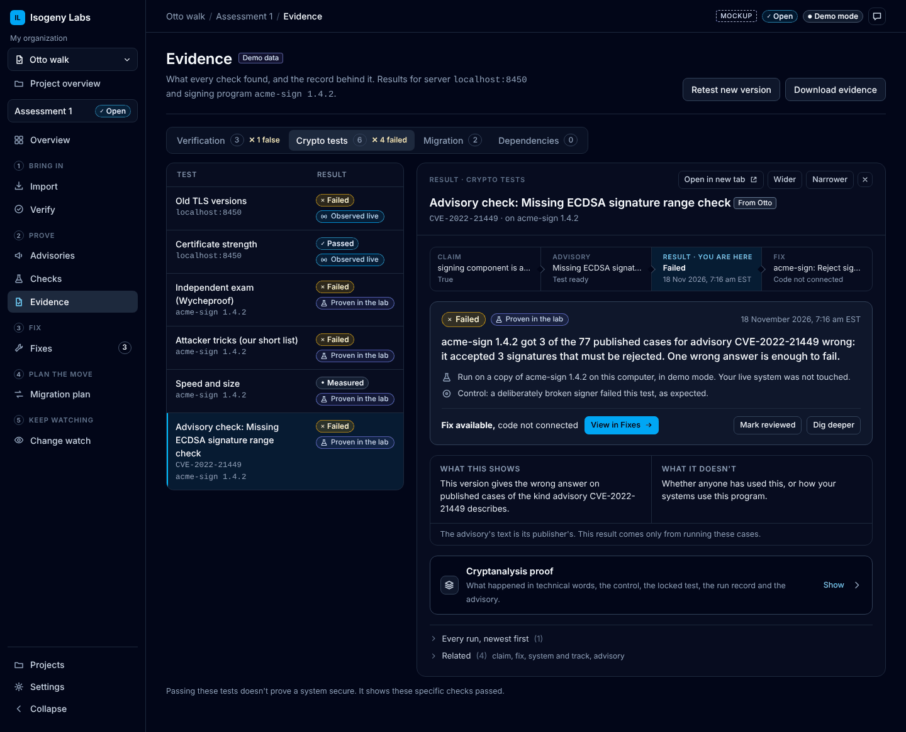
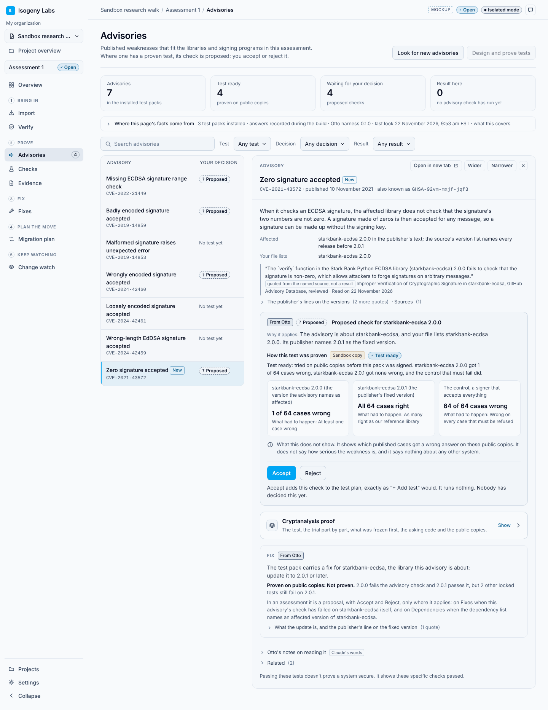
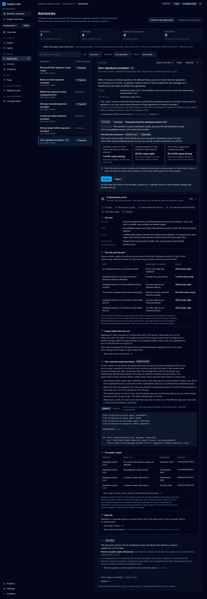
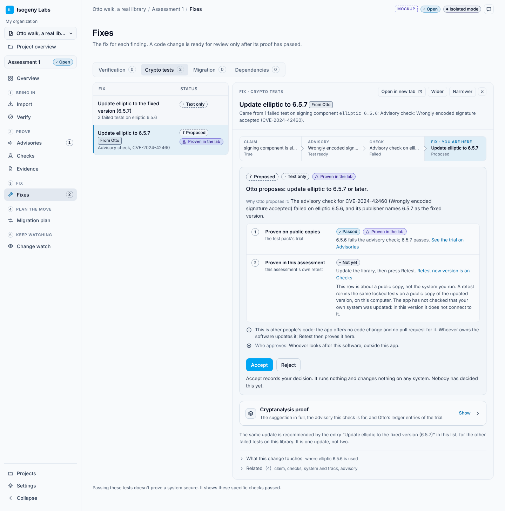
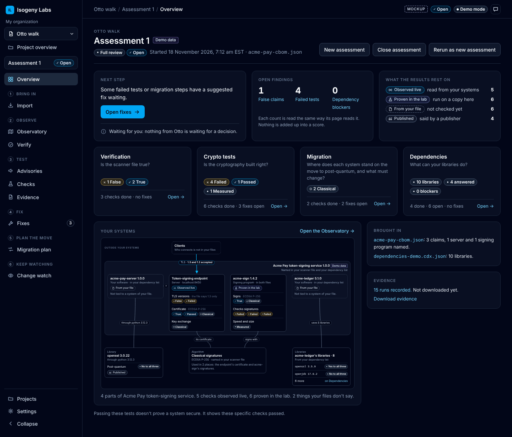

# Design refactor: evidence a busy security engineer can read at a glance

**Status: a plan and mockups only. Nothing is built. It waits for Kevin's approval.**
Written 25 November 2026. No app code, result, rule, answer key or reviewer was changed to make it.

## The plan on one page

**The problem.** The product's promise is: prove your crypto continuously, with evidence a busy security engineer can read. Today the proof screens are written for a cryptographer and shown to the engineer. Two examples, measured on the app's own screenshots:

- **A test result on Evidence opens 4,265 pixels tall** at 1440 pixels wide. That is nearly five screens, all of it open at once: the answer, the technical summary, the table of cases, the run record, the locked test, the control, the advisory, where the check came from, the fix. Nothing says which of those is the answer.
- **A proposed check on Advisories writes the same three counts five times** ("1 of 64 wrong, none wrong, the control failed"): three times in the open and twice more inside its proof. Its proof is already behind a fold today, but opened it is 4,053 pixels of paragraphs in a single column.

**What I propose, in five changes.**

1. **Three layers for every proof.** First the answer in plain English. Then what it shows and what it doesn't. Then one dropdown, **Cryptanalysis proof**, folded shut, that holds every record a cryptographer or an auditor wants, whole: the published cases, the control, the locked test, the run record, the code, the fingerprints. The same three layers on every result, every proposed check and every fix.
2. **One tab strip, the same everywhere.** The four work groups stay as they are. Each tab gains a count and says how many findings it holds. The sidebar stops repeating the tabs.
3. **A sidebar that tells the story.** Five numbered steps: Bring in, Prove, Fix, Plan the move, Keep watching. Nine entries where there are up to seventeen today.
4. **One fixed place for each kind of label.** The result, what it rests on, and where it came from stop competing for the same spot.
5. **Calm pages.** Every page in the same order: title, a few numbers, the table, and the detail in a side panel.

**What it does to the two examples.** The same test result opens at 1,166 pixels in the mockup, with every record one click away. The proposed check says its counts once in the open and once, as a table, inside the proof.

**What does not change.** No result, no check, no test, no rule, no answer key, no evidence file. The reviewer is not touched. Every product rule in `CLAUDE.md` stands: no "secure", no score, no severity, plain words. No record is shortened: what is folded is shown whole when opened.

**What I need from Kevin.** Five decisions, listed in [section 9](#9-decisions-for-kevin). The first is simply: is this the right direction?

**See it first.** All the pictures are in [section 8](#8-the-mockups). The one that shows the idea fastest is the same result, as it opens today and as it would open:

---

## 1. Why: who uses this and what they decide

**The user** is one security engineer at a company that handles payments or sensitive data. They are busy and they are not a cryptographer (SPEC, "Why this exists"). They open the app with three questions, always in this order:

| Their question | What answers it | Where it sits in the new layout |
|---|---|---|
| **What did you find?** | The reviewer's word (Passed, Failed, True, False) and one plain sentence | Layer 1, top of every panel |
| **Can I trust that?** | What it rests on (observed on my system, or proven on a copy), and that the test caught a deliberately broken program | Layer 1 says it in two lines. The full record is one click away in layer 3. |
| **What do I do next?** | The fix, or the decision that waits for me | The bottom line of layer 1, with its one button |

**The second reader** is the person the engineer has to convince: an auditor, or a cryptographer on their own team. That reader wants the opposite: every case, the control, the exact code, every fingerprint. Today's screens are built for this second reader and shown to the first. The redesign keeps everything the second reader needs, whole, in one named place, and stops making the first reader wade through it.

**How this serves "proof, continuously".**

- *Proof* is never more than one click away, and it is always in the same place under the same name. That consistency is what makes it believable: the engineer learns once where the proof lives.
- *Continuously* shows in two things. One is a short line of links at the top of every panel (claim, advisory, check, result, fix) that shows where this item sits in the loop; this plan calls it the trail. The other is a sidebar whose last step is "Keep watching".
- *Readable* means the first screen of any item answers the three questions.

**The business case.** The demo has to land in five minutes (SPEC). Today a presenter who opens a result gets nearly five screens at once. One who opens a proposed check's proof to show it has to scroll through four screens of fingerprints and code to get back to Accept. After the change the demo is four beats: here is the finding, here is why you can trust it, click here to see the cryptanalysis, here is the fix. The same screens also put the honest limits ("what this does not show") where a technical buyer will see them, and that is what earns their trust.

---

## 2. The journey, and where it is confusing today

**The journey in five steps.**

| Step | Pages | What the user does | What they leave with |
|---|---|---|---|
| 1. Bring in | Import, Verify | Upload the scanner's file. Check each claim against the real system. | True, False or Couldn't check for every claim |
| 2. Prove | Advisories, Checks, Evidence | Accept or reject proposed checks. Run the tests. Read what each one found. | A result for every test, each with its record |
| 3. Fix | Fixes | See the fix for each finding and its proof. Approve, merge or apply. | A fix that is proven before it is offered |
| 4. Plan the move | Migration plan | See where each system stands on post-quantum and what must change. | A plan with measured costs |
| 5. Keep watching | Change watch | See what a developer's change, or a newly published weakness, means for all of the above. | The loop starts again |

**Where today's flow loses people.** Each point is taken from the current screens.

1. **The sidebar is a list, not a path.** It shows up to seventeen entries inside one assessment with no sign of order. When Evidence is open, the words "Migration" and "Dependencies" each appear twice in the sidebar at the same time: once as tabs of Evidence and once as the Migration pages. (See `docs/screenshots/group-tabs/evidence-2-encryption-panel-open-light.png`.)
2. **Two ways to do the same thing.** The four work groups are tabs on the page and also entries in the sidebar. Migration's three views (Systems, Roadmap, Dependencies) are tabs on the page and also entries in the sidebar. A user cannot tell whether these are the same thing.
3. **Checks and Evidence look like the same page.** Both list the same items in the same four groups. The difference (Checks is what runs; Evidence is what it showed) is not visible in the layout.
4. **One finding lives on four pages, and the links between them are at the bottom.** The Related block that ties a claim to its check, result and fix sits at the very end of the longest panels. On the result pictured above it is about 4,000 pixels down.
5. **Panel titles are crushed.** The buttons "Open in new tab", "Wider", "Narrower" and × share a line with the title and take most of it. Titles break one or two words per line. On the Watch list a title runs to eight lines (`docs/screenshots/sandbox/06-watch-list-the-item-open-dark.png`).
6. **On Advisories the list starts far down the page.** Background text comes first: the standing line, the installed packs, where answers were recorded, the harness version, the waiting count, and the New advisories block with its run report and a long paragraph on what the loop covers. The table of advisories begins about 1,200 pixels down, on the second screen (`docs/screenshots/sandbox/13-the-proposal-how-this-test-was-proven-dark.png`).
7. **"Verify" and "Verification" are different things with nearly the same name.** Verify is the page where claims are checked. Verification is the tab that lists those checks.

**What fixes each of these** is in sections 3 and 5. In short: a five-step sidebar (1, 2), one sentence that separates Checks from Evidence and different columns for each (3), the trail at the top of every panel (4), a panel header where the title has the full width (5), a calm Advisories page (6), and the group's own question shown under the tab (7).

---

## 3. Tabs and tags: the cleanest structure

### The four work-group tabs

**My finding: the four groups are right. The trouble is around them.** Verification, Crypto tests, Migration and Dependencies are the same names in the same order on Checks, Evidence, Fixes and the Overview. That is worth keeping exactly. What I would change:

| Today | Proposed | Why |
|---|---|---|
| A tab shows its name. Only while a search or a filter is on does it also show how many of its rows match. | A tab always shows its name, how many items it holds, and how many of them are findings: "Crypto tests 6 · ✕ 4 failed". While a search or a filter is on, the number is the matching rows, as today. | The user sees where the findings are before clicking. |
| The group's question and its counts sit in a separate strip, and four summary cards sit above the tabs. | One band under the tabs holds the group's question ("Is the cryptography built right?"), its Open, In progress and Done counts, and its numbers. | One place to look. The numbers belong to the open tab, so they sit under it. |
| The sidebar repeats the four groups under whichever page is open. | The sidebar does not repeat them. | One way to move between groups, not two. It also removes the doubled "Migration" and "Dependencies". |
| The sidebar entry is "Migration"; the page it opens is titled "Migration plan". | The sidebar entry is "Migration plan" too. Its three views stay as tabs on the page only. | "Migration" then always means the work group, and "Migration plan" always means the page. |
| Checks and Evidence show near-identical tables. | Checks has the columns of a to-do list: test, runs on, latest result, Run. Evidence has the columns of a record: test, result, rests on, fix, last run. Each page says its role in one sentence under the title. | The two pages stop looking like copies. |

**The numbers on a tab are the page's own counts and decide nothing.** They are counted the way the page already counts. Anything the rules keep out of every count stays out: on Fixes, the entry that comes from Change watch is counted nowhere today and would not be counted on a tab either.

The same strip on Checks, with the test plan as compact rows ("Why it matters" opens under a row, shown here on the first one):

On the Overview the four groups stay side by side as four cards, as today, each with its question and its counts in the reviewer's words (picture in section 8).

### The source tags and the other labels

**Are four source tags too many? No.** Observed live, Proven in the lab, From your file and Published each answer a different question, and Kevin approved their words and colours on 22 November. They stay exactly as they are.

**The real problem is that every label looks alike and sits wherever it fits.** One fix on today's Fixes page opens with four pills of the same shape (Proven in the lab, Ready for review, From a fix template, Demo data). The proposal is three kinds of label, each with its own shape and its own fixed place, and at most one of each on a row:

| Kind | What it tells you | Shape | Fixed place | Examples |
|---|---|---|---|---|
| **1. The result or status** | What the check decided, or where a fix stands | A filled pill with a symbol. The loudest thing on the row. | The Result column in a table. Top left of the summary in a panel. | Passed, Failed, True, False, Measured, Proposed, Ready for review |
| **2. What it rests on** | Whether it was observed, tested on a copy, read from the file, or published | A quiet outlined pill with a small picture (a signal, a flask, a page, a quote mark) | Its own column, **Rests on**, in a table. Beside the result in a panel. | Observed live, Proven in the lab, From your file, Published |
| **3. Where it came from** | Who or what produced the item | A small square label after the name | After the item's name | From Otto, Demo data, New, Sandbox copy, Written by Otto |

A short legend of the four tags sits once in the toolbar above each table, so nobody has to hover to learn them. It is a legend only: there is no filter by source, as the SPEC says.

The many small tags inside the evidence ("measured", "demo", "reference", "assumed", "from the file") keep their words and stay on the facts they label. Those facts are in the Cryptanalysis proof, so the small tags no longer sit next to the answer.

---

## 4. The layered proof (the centrepiece)

### What happens today

- **A result on Evidence** is one long column with everything open. Nothing is folded.
- **A proposed check on Advisories** already folds "How this test was proven". But the same counts are written three times above the fold as well, and inside the fold everything is paragraphs in one column.
- **A library's fix on Fixes** states the update six times and its two proof rows three times.

So the app already has folds. What it lacks is one rule for what goes above the fold and what goes below it. That rule is the proposal.

### The pattern

Three layers, always in this order, with the same names and the same position on every screen that shows a proof.

| Layer | What it is | What it holds | Open or folded |
|---|---|---|---|
| **1. At a glance** | The answer, for the security engineer | The result and what it rests on. One plain sentence. Two short lines: where it ran, and the control. The next step with its one button. | Always open |
| **2. What this shows, and what it doesn't** | The honest limits | The app's own lines on what the result shows and what it does not. | Always open |
| **3. Cryptanalysis proof** | The deep record, for the cryptographer and the auditor | Every record, whole: the technical summary, the published cases and the answers given, the control, the test as it was locked before the run, the run record, the code, the fingerprints and the ledger entries. | **Folded.** One click opens it. Its header says what is inside. |

This is also what the SPEC already asks of a result: "one plain sentence... with the technical text and the evidence folded under it". Today's Evidence panel shows the technical text and the evidence open. The pattern puts them where the SPEC says.

Inside the Cryptanalysis proof the parts are numbered, each has a plain heading, and short links at the top jump to each. A list that has columns becomes a table. The heaviest parts (the list of frozen files, the ledger entries, the second author's code) stay folded one level further, as they are today.

### Where the pattern applies

| Place | Layer 1, the answer | Layer 3, the Cryptanalysis proof |
|---|---|---|
| A test result on Evidence | The reviewer's word, the plain sentence, where it ran, the control line, the fix line | What happened in technical words, the control, the locked test, the run record, the advisory, where the check came from |
| A proposed check on Advisories ("How this test was proven") | Why it applies, the test's status with its reason, three counts (affected version, fixed version, the control), what it does not show, Accept and Reject | The test, the trial part by part, what was frozen before the first run, the code that asked the library, the public copies, the records |
| A library's fix on Fixes | What is proposed and why, the **two proof rows** with the note under the second, who approves, Accept and Reject | The suggestion in full, the advisory, the ledger entries |
| A code fix's proof on Fixes | Proof passed or failed, and the one-sentence summary | The table of every test rerun on the changed code, the commits and fingerprints |
| A change on Change watch | The status ("Passed before, fails now"), the plain sentence | The picked tests and the rule that picked each, before and now, the diff |

### Mockup: a test result, collapsed and expanded

Collapsed. The engineer's whole answer is on one screen:

Expanded. Every record from today's screen is here, whole, in six numbered parts:

### Mockup: a proposed check ("How this test was proven"), collapsed and expanded

Collapsed. Why it applies, the three counts that matter, what it does not show, and the decision:

Expanded. The trial as a table, the frozen record, the code that asked the library, the public copies:

Opened, the proposed check is about as long as it is today, on purpose: nothing was left out. The difference is the order. Today's proof opened, beside the mockup opened the same way:

### Mockup: a fix with its two proof rows

The two rows keep their exact words ("Proven on public copies", "Proven in this assessment"), and the note that says what the second row is about stays right under it, as the SPEC requires. They become a two-step ladder, so it is plain that the second step is still to do:

### The fluff to cut

I sorted what repeats into three kinds, because they are not the same decision.

**Kind A: drawn twice today, drawn once after.** These are true cuts on the screen. Each is a second copy of something that stays. No record loses anything.

| # | Where | What is drawn twice today | What stays |
|---|---|---|---|
| A1 | A proposed check | The trial's three counts as a bullet list ("How it did when tried on public copies") and again as the rows of "How this test was proven". | The table, inside the dropdown. Where an advisory has only the bullet list (a test tried on our pinned copies), the list stays. |
| A2 | A proposed check | The test's question, its cases and its control: once under "The test", and again as the proposal's own bullets. | "The test", inside the dropdown. The proposal keeps its bullets on pages where it stands alone. |
| A3 | A proposed check | "Accepting adds the check to the test plan and runs nothing": above the proposal and again under its buttons. | The sentence under the buttons. |
| A4 | A library's fix | The two proof rows: as a bullet in the proposal, as the two rows, and again as sentences. | The two rows in the open. The sentences stay inside "The suggestion", in the dropdown, because that text is one record. |
| A5 | A library's fix | The fix's title, written again as the proposal's own title directly under it. | The panel's title. |
| A6 | A library's fix | "This is other people's code: the app offers no code change and no pull request": as a bullet and again under "What it suggests". | Once, in the open. |
| A7 | Advisories | The standing line "Passing these tests doesn't prove a system secure..." at the top of the page and again at the foot of the panel. | Once on every screen, as a quiet line. Every page that has it today keeps it. |
| A8 | Every panel | Boxes inside boxes: the page, the block, the card, the proof, the list. Up to five levels of border. | Two levels at most. Spacing and thin lines do the rest. |

**Kind B: said in the open today, moved into the dropdown.** Nothing is cut. It is one click away, whole.

| # | Where | What moves into the Cryptanalysis proof |
|---|---|---|
| B1 | A result | The "Technical summary" line and "What happened". They are the technical telling of the plain sentence. They become part 1. |
| B2 | A result | The table of wrong cases, the run record and the locked test, each whole. |
| B3 | A result | The "Control" paragraph. One line about the control stays in the open, moved from under the title into layer 1. |
| B4 | A result | The advisory box and "Where this check came from", each whole, with its own note. |
| B5 | A proposed check | "The test": its question, cases, control, pass rule and design fingerprint. |
| B6 | A proposed check | The two quoted version lines (`"introduced": "0"` and `"fixed": "2.0.1"`), folded into one line. The publisher's own sentence stays in the open with its caption. |
| B7 | A library's fix | "The suggestion" in full, and the advisory it answers. |
| B8 | Advisories, the page | The lines about installed packs, recorded answers and the harness, and the paragraph on what the loop covers: folded into one line, "Where this page's facts come from", directly above the list. |
| B9 | Checks | Each test's "Why it matters": it opens under the row. |

**Kind C: the same fact worded twice by the app. Not in this plan.** These would shorten the screens further, but the screens cannot tell that two differently worded sentences say the same thing. Cutting one means changing which sentences the app writes, and that is more than presentation. I list them so you can decide later; this plan leaves all of them as they are.

| # | The pair |
|---|---|
| C1 | "Test ready: tried on public copies before this pack was signed..." and "Tried on public copies of starkbank-ecdsa fetched from PyPI...": the same three counts in two sentences. In the mockup the first is in the open and the second opens the trial inside the dropdown. |
| C2 | Three notes that the result comes only from the test, each worded differently, one on each block of a result. |
| C3 | "Update the library, then press Retest." and "To prove it here: whoever owns the software updates it; then press Retest new version..." on a library's fix. |
| C4 | The plain sentence and the "Technical summary" of a result, where the second adds only the number of the first wrong case. |

**After A and B, the five copies from the top of this plan become two:** one in the open (a sentence, with its three counts drawn under it) and one inside the dropdown (a sentence, with the full table under it).

### What to keep

Everything that carries a fact stays. In particular:

- The reviewer's word and the one plain sentence, unchanged.
- "What this shows, and what it doesn't" and "What this does not show". These are the product's honesty. They stay in the open, not behind the fold.
- The control line. It is the shortest answer to "can I trust this?", so it stays in layer 1. It gets a plain mark, not a tick: a tick would read as a second result.
- The source tag and its one sentence ("Run on a copy... Your live system was not touched").
- Every record, whole: the locked test with all its fields, the run record with its full summary, the ledger entries, the decisions, the quoted lines, the code.
- The exact sentences the rules require: that the screen of the asking code is "a filter for mistakes and plain tricks, not a proof"; that a replay was "not by an outside party"; who wrote the code; whose counts are the reviewer's.
- The words the app chooses by case. The label of the fixed version is the app's own, so where the publisher named no fixed version it still says so.
- The two proof rows of a library's fix, word for word, with the note under the second row and its link to Checks.
- On an advisory's Fix block, where the fix becomes a proposal with Accept and Reject.
- Accept and Reject on each proposal by itself, with the sentence that accepting runs nothing.

### One naming rule to settle

"Cryptanalysis proof" fits where cryptography was tested against published cases with a control: test results, advisory checks, test proofs and fix proofs. For an item that was only *observed* (a handshake with your server on Verify, a migration measurement) the name would claim more than happened. For those I recommend the same dropdown in the same place under the name **Technical record**. This matches the source tags: "Proven in the lab" gets a Cryptanalysis proof, "Observed live" gets a Technical record. It is decision B in section 9.

---

## 5. Calm pages

**Every page in the same order.**

1. **The title, one sentence, and the page's one or two main buttons.**
2. **A few numbers**, counted from what the page shows.
3. **The tabs**, where the page has groups.
4. **Search and filters**, on one line.
5. **The table.** One row per item. A name, one line of plain words, the result, what it rests on.
6. **The side panel**, when a row is clicked. Never everything at once on the page.

**Every side panel in the same order.**

1. **A slim tool row**: where you are ("Result · Crypto tests"), then Open in new tab, Wider, Narrower and ×. The buttons no longer share a line with the title.
2. **The title on its own line**, at the panel's full width.
3. **The trail**: up to four short steps (claim, advisory, check or result, fix), the current one marked, each a link. It is built from the links the Related block already holds, and brings them from the bottom of the panel to the top. The Related block itself stays, folded, at the foot.
4. **Layer 1, layer 2, layer 3.**
5. **Folded lines** at the foot: earlier runs, Related, what this change touches.

**Five rules that keep a page calm.**

- **One answer per screen.** The top of a panel answers the three questions.
- **No box inside a box inside a box.** Two levels of border at most.
- **Text no wider than a comfortable line** (about 70 characters), so a sentence reads in one glance.
- **Tables for anything with columns.** The trial's six parts and the wrong cases are tables, not stacked paragraphs.
- **A fold is only a fold.** It opens on a click and holds whole records. Nothing clever.

**What this does to three busy pages.**

- **Advisories.** Four numbers and the top of the list are on the first screen. A row's panel opens on the proposal and its decision. (Mockup 06.)
- **Checks.** The test plan is a compact table. Retests and fix proofs are single folded lines until there is something in them. (Mockup 02.)
- **Overview.** Three cards answer the three questions (the next step, the open findings, what the results rest on), then the four groups. No score, no bar, no trend line. (Mockup 01.)

---

## 6. Benefits

| Change | What the user gets | What the product gets |
|---|---|---|
| Three layers for every proof | The answer in five seconds. The proof in one click. | A demo that reaches the point before the audience drifts. Proof that looks deliberate instead of dumped. |
| A result that opens short | The same result opens at 1,166 pixels instead of 4,265. | The first thing an investor sees on Evidence is a finding, not a wall. |
| Each headline fact said once in the open | No hunting for which of five copies is the real one. | Fewer places for two sentences to drift apart when wording changes. |
| "What it doesn't show" always in the open | They know the limits before they rely on a result. | Honesty is visible. That is the product's edge over tools that only assert. |
| One tab strip with counts | They see where the findings are without clicking through four tabs. | The four work groups become the product's recognisable backbone. |
| A five-step sidebar | They always know where they are and what comes next. | The sidebar itself tells the story: bring in, prove, fix, plan, keep watching. |
| One place for each kind of label | A row reads left to right: what, result, rests on. | The four source tags finally do their job. They are the "live or lab" story at a glance. |
| A panel title with room | Names are readable. | Screenshots and demos look finished. |
| Advisories with the list on the first screen | They see what waits for them at once. | "Otto proposes, a person decides" is visible in one screen. |

**What it does not buy.** An opened proof is not shorter than today. On the proposed check it is about the same length, because every record is kept whole. The gain there is order, not length.

**What it costs.** The work is in the screens, but it is not small. The screen tests (about 40 files) and the end-to-end walks (20 files) that read these panels have to follow the new layout, and the layout walk that measures every table page at 1440 pixels wide has to pass again. Most reference screenshots would be retaken.

---

## 7. Scope: what this is and is not

**Presentation only.** This plan changes where things sit on the screen and whether a second copy is drawn. It does not change:

- any result, check, test, verdict or count;
- the reviewer (`backend/app/engine/reviewer.py`), the runner, or any rule;
- the answer keys in `demo/`;
- the signed evidence file, the report, the ledgers or the verify command;
- what Otto may do, and what needs a person's click;
- `docs/wireframes/` (the folder is not in this repository, so nothing there was read or touched).

**The product rules, and how the mockups keep them.**

| Rule | In the mockups |
|---|---|
| Never "secure", no score, no severity | None appears. The one use of the word is the app's own standing line, kept word for word on every screen. The Overview has counts only. |
| Results come only from checks and tests | Every result chip is the reviewer's word as today. Tab numbers are counts of rows. No tick or cross is drawn on anything the reviewer did not decide. An empty Fix cell says nothing; it does not say that no fix is needed. |
| "How this test was proven" shows counts and never Passed or Failed | The three counts and the trial table show counts and what had to happen. No pass or fail mark is drawn on them. |
| The screen of the asking code is never called a proof | The sentence "a filter for mistakes and plain tricks, not a proof" is kept, inside part 4. See the naming note below. |
| A fixed version the publisher did not name is never called the publisher's | The label on each count is the app's own, which already changes its words in that case. |
| A library's fix carries its two proof rows in the same words | Kept word for word, with the note under the second row. |
| Each proposal is decided by itself, and accepting runs nothing | Accept and Reject are on each proposal, with that sentence beside them. |
| Plain-language text | Layer 1 uses only the app's own plain sentences. |

**What the screens can do alone, and what needs a little more.** "Presentation only" has an edge, and I want to be exact about it.

*The screens can do these with what the app already sends:*

- The three layers. Each block that moves is already a separate piece on the screen.
- The trail. It uses the links the Related block already has.
- The numbers on the tabs, the sidebar, the panel header.
- The trial as a table (each part already arrives with its name, its count and what had to happen) and the wrong cases as a table (already one).

*These need a small addition to the part of the app that turns stored results into sentences* (`backend/app/present/`). It decides nothing and changes no result, but it is not the screens alone:

1. **Two columns for "what this shows" and "what it doesn't".** Today the app sends those lines as one list. To split them cleanly it has to send two. Without this, layer 2 stays one block under today's heading, which is fine.
2. **The public copies as a table.** Each copy arrives as one sentence, with its version, date and fingerprint also sent apart. A table of version, date and fingerprint can be drawn today; the file's name and where it was fetched from stay in the sentence, folded under the table.
3. **A few fixed labels**: "Cryptanalysis proof" and the one line under it, "Where this page's facts come from". These are fixed words like today's "Technical summary".
4. **Numbers on the sidebar** (proposals waiting, open fixes). They are the Overview's own counts, read on every page.

*Not proposed:*

- Any of Kind C above (choosing between two sentences the app writes).
- A tick or cross on each row of a trial. It would read as a result.
- The math in symbols. The app says what a test checks in words ("zero or outside the allowed range"). A line of symbols would be new content and would need its source, like every other fact.
- Merging Checks and Evidence into one page. It would undo the flow in the SPEC.
- Any change to the Otto panel. Its layout beside a detail panel deserves its own look later.

**The SPEC would need these edits on approval.** `CLAUDE.md` says every screen element must be in SPEC section 2, so each of these is a change you would be approving. I would write out the exact new wording for your OK before any build.

| # | What changes in SPEC section 2 |
|---|---|
| 1 | A new paragraph: the three layers and the Cryptanalysis proof dropdown. |
| 2 | The sidebar: five numbered steps, nine entries, "Migration plan". It no longer "lists the four under the page that is open". |
| 3 | The tabs: a count on each, always. |
| 4 | Where the source tag sits: its own "Rests on" column, and a legend in the toolbar. |
| 5 | The order of a result's panel on Evidence, and of an advisory's panel. |
| 6 | Advisories: the top blocks folded into one line; the two research buttons in the page header. |
| 7 | The trail at the top of every panel (new). |
| 8 | Checks: a test's "Why it matters" opens under its row instead of standing on the card. |
| 9 | Overview: one count by tag for the whole assessment (new). Each group's own count by tag stays on its card, though the mockup does not draw it. |
| 10 | The code that asked the library: the second author's version on a switch beside the first instead of under it. "Show the code" stays. |
| 11 | The publisher's two version lines folded on an advisory's panel. |

**A naming note.** The rules say the screening of the asking code is "never called a proof". In the mockups that part sits inside a dropdown named "Cryptanalysis proof". The name describes the whole record, and the sentence that the screen is a filter and not a proof is kept inside it. If that still reads as too close, the dropdown can be named "Cryptanalysis record" at no cost. It is part of decision B.

---

## 8. The mockups

One throwaway file, [`design-refactor/mockups/mockups.html`](design-refactor/mockups/mockups.html), holds every screen. It is not the app and is not connected to it. Open it in a browser: the purple bar at the top switches the screen, the dark or light look, and the dropdown open or closed. The pictures below were taken from it with the repo's Playwright, at 1440 pixels wide.

Sentences are the app's own wherever the app has one, read from the existing screenshots, and the demo data is the same. A few short lines are stand-ins where I shortened the app's sentence to show the idea (the sentence under each page title, the one-line test descriptions on Checks); a build would use the app's own words.

| # | Screen | Dark | Light |
|---|---|---|---|
| 01 | Overview | [picture](design-refactor/mockups/01-overview-dark.png) | [picture](design-refactor/mockups/01-overview-light.png) |
| 02 | Checks, with the proposed tabs and a compact test plan | [picture](design-refactor/mockups/02-checks-tabs-dark.png) | [picture](design-refactor/mockups/02-checks-tabs-light.png) |
| 03 | Evidence, with the proposed tabs | [picture](design-refactor/mockups/03-evidence-tabs-dark.png) | [picture](design-refactor/mockups/03-evidence-tabs-light.png) |
| 04 | A result, Cryptanalysis proof **collapsed** | [picture](design-refactor/mockups/04-result-proof-collapsed-dark.png) | [picture](design-refactor/mockups/04-result-proof-collapsed-light.png) |
| 05 | A result, Cryptanalysis proof **expanded** | [picture](design-refactor/mockups/05-result-proof-expanded-dark.png) | [picture](design-refactor/mockups/05-result-proof-expanded-light.png) |
| 06 | A proposed check, Cryptanalysis proof **collapsed** | [picture](design-refactor/mockups/06-test-proof-collapsed-dark.png) | [picture](design-refactor/mockups/06-test-proof-collapsed-light.png) |
| 07 | A proposed check, Cryptanalysis proof **expanded** | [picture](design-refactor/mockups/07-test-proof-expanded-dark.png) | [picture](design-refactor/mockups/07-test-proof-expanded-light.png) |
| 08 | A fix with its two proof rows, collapsed | [picture](design-refactor/mockups/08-fix-two-proof-rows-dark.png) | [picture](design-refactor/mockups/08-fix-two-proof-rows-light.png) |
| 09 | A fix, Cryptanalysis proof expanded | [picture](design-refactor/mockups/09-fix-proof-expanded-dark.png) | [picture](design-refactor/mockups/09-fix-proof-expanded-light.png) |
| | Before and after: the tabs on Evidence | [picture](design-refactor/mockups/compare-tabs-dark.png) | [picture](design-refactor/mockups/compare-tabs-light.png) |
| | Before and after: one result, as it opens | [picture](design-refactor/mockups/compare-result-proof-dark.png) | [picture](design-refactor/mockups/compare-result-proof-light.png) |
| | Before and after: one proposed check, both opened | [picture](design-refactor/mockups/compare-test-proof-dark.png) | [picture](design-refactor/mockups/compare-test-proof-light.png) |

**How the before-and-after pictures compare.** Each sets like beside like. The result is shown as it opens today and as it would open. The proposed check is shown with its proof opened on both sides. The mockup's pictures also carry the page's header and the list beside the panel, which the "before" picture of the proposed check does not (it was taken on a page of its own).

The Overview, where the three cards answer the three questions:

The "before" pictures are the app's own screenshots, already in the repository:
`docs/screenshots/phase5c/3-00-evidence-result-where-the-check-came-from-*.png`,
`docs/screenshots/sandbox/15-the-proposal-with-its-whole-proof-*.png`,
`docs/screenshots/phase5c/9-01-real-library-fix-two-proof-rows-*.png` and
`docs/screenshots/group-tabs/evidence-2-encryption-panel-closed-*.png`.

**Not mocked, and how they would follow.** Verify, the Migration plan, Dependencies, Change watch, Settings and the Otto panel were studied but not drawn. Each would take the same page order and the same panel order from section 5. Verify and the Migration plan would take the three layers with the dropdown named as decision B settles.

The mockups, their pictures and the small script that takes them (`shoot.mjs`) are disposable. Delete the folder `docs/plans/design-refactor/` once a decision is made.

---

## 9. Decisions for Kevin

| | Decision | My recommendation |
|---|---|---|
| **A** | Is the direction right: three layers, with every record folded whole under one dropdown? | Yes. It is the change that does the most for the least risk. |
| **B** | The dropdown's name. "Cryptanalysis proof" everywhere? Or "Cryptanalysis proof" for what was tested and "Technical record" for what was only observed? Or "Cryptanalysis record" throughout, to stay clear of the word "proof" around the asking code? | "Cryptanalysis proof" for tested items, "Technical record" for observed ones. |
| **C** | The sidebar: five numbered steps and nine entries, with the group tabs and Migration's three views no longer repeated there, and "Migration" renamed "Migration plan". | Yes. |
| **D** | The eleven SPEC edits in section 7, among them the count on every tab, the trail, the "Rests on" column with its legend, and the calmer Advisories page. | Yes to all. Say which, if any, you would rather leave as they are. |
| **E** | The small additions outside the screens (section 7: the two columns for "shows" and "doesn't", the public copies as a table, the sidebar numbers). Allow them, or hold the build to the screens alone? | Hold the first build to the screens alone. Add these afterwards, one at a time, once the layers are in. |

---

## 10. If approved: how it would be built

Not started. Each step would get its own short plan, be built, reviewed, and shown to you with tests and screenshots before the next, as `CLAUDE.md` asks.

1. **The proof on Evidence.** The three layers on a test result. This is the smallest step that proves the idea in the real app.
2. **The proof on Advisories and Fixes.** "How this test was proven" and the two proof rows, in the same three layers.
3. **The tabs and the labels.** Counts on the tabs, the "Rests on" column, the three kinds of label.
4. **The panel header and the trail.**
5. **The sidebar and the calm pages** (Advisories, Checks, Overview), with the SPEC edits.

After each step: the screen tests, the end-to-end walks, the layout walk at 1440 pixels, and the accuracy check, which must match the answer keys exactly as it does today, because nothing behind the screens will have changed.
