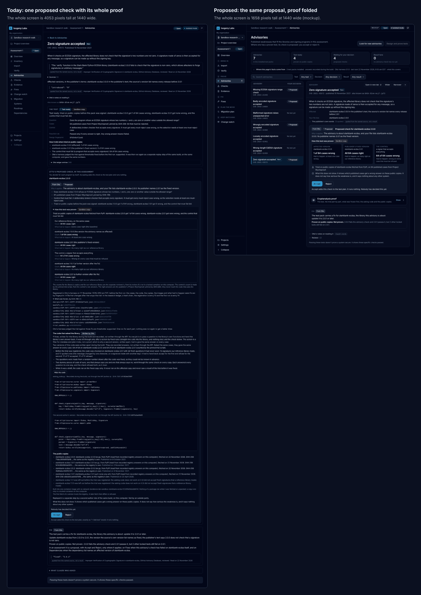
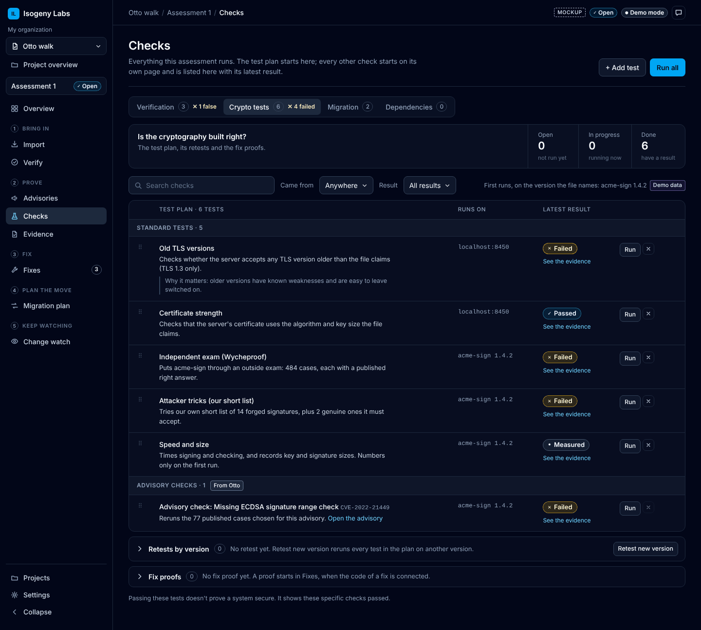
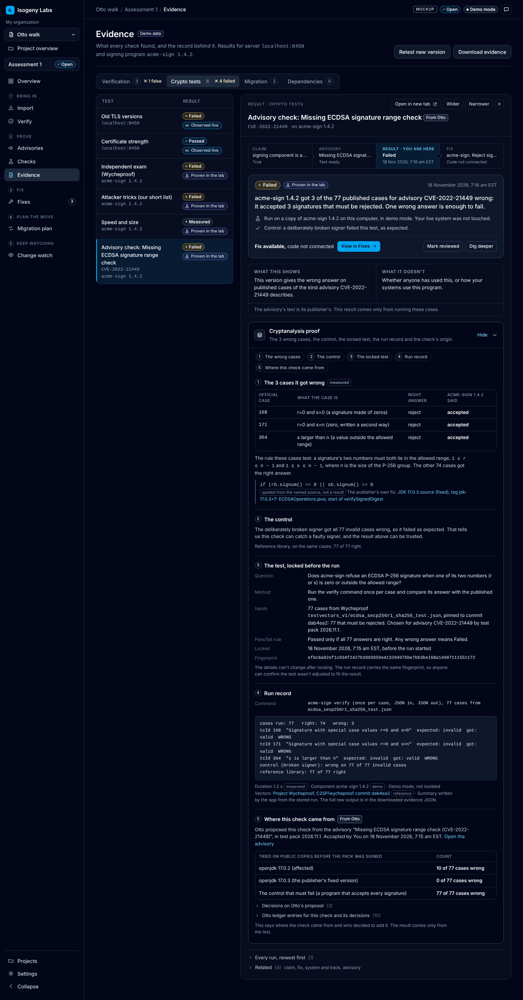
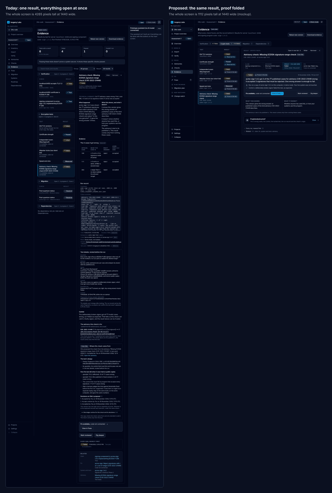

# Design refactor: evidence a busy security engineer can read at a glance

**Status: a plan and mockups only. Nothing is built. It waits for Kevin's approval.**
Written 25 November 2026. No app code, result, rule, answer key or reviewer was changed to make it.

## The plan on one page

**The problem.** The product's promise is: prove your crypto continuously, with evidence a busy security engineer can read. Today the proof screens are written for a cryptographer and shown to the engineer. Measured on today's own screenshots:

| Screen today | How tall it is (at 1440 pixels wide) | The same screen in the mockup, proof folded |
|---|---|---|
| One proposed check with its proof (Advisories) | 4,053 pixels, about four and a half screens | 1,658 pixels |
| One test result (Evidence) | 4,265 pixels | 1,112 pixels |

On the first of those screens the same three counts ("1 of 64 wrong, none wrong, the control failed") are written **five times**. Nothing on the screen says which of the forty-odd paragraphs is the answer.

**What I propose, in five changes.**

1. **Three layers for every proof.** First the answer in plain English. Then what it shows and what it doesn't. Then one dropdown, **Cryptanalysis proof**, folded shut, that holds everything a cryptographer or an auditor wants: the published cases, the control, the code, the fingerprints, the records. The same three layers on every result, every proposed check and every fix.
2. **One tab strip, the same everywhere.** The four work groups stay as they are. Each tab gains a count and says how many findings it holds. The sidebar stops repeating the tabs.
3. **A sidebar that tells the story.** Five numbered steps: Bring in, Prove, Fix, Plan the move, Keep watching. Nine entries where there are up to seventeen today.
4. **One fixed place for each kind of label.** The result, what it rests on, and where it came from stop competing for the same spot.
5. **Calm pages.** Every page in the same order: title, a few numbers, the table, and the detail in a side panel.

**What does not change.** No result, no check, no test, no rule, no answer key, no evidence file. The reviewer is not touched. Every product rule in `CLAUDE.md` stands: no "secure", no score, no severity, plain words.

**What I need from Kevin.** Six decisions, listed in [section 9](#9-decisions-for-kevin). The first is simply: is this the right direction?

**See it first.** The pictures are in [section 8](#8-the-mockups). The two that show the idea fastest:

---

## 1. Why: who uses this and what they decide

**The user** is one security engineer at a company that handles payments or sensitive data. They are busy and they are not a cryptographer (SPEC, "Why this exists"). They open the app with three questions, always in this order:

| Their question | What answers it | Where it sits in the new layout |
|---|---|---|
| **What did you find?** | The reviewer's word (Passed, Failed, True, False) and one plain sentence | Layer 1, top of every panel |
| **Can I trust that?** | What it rests on (observed on my system, or proven on a copy), and that the test caught a deliberately broken program | Layer 1 says it in two lines. The full record is one click away in layer 3. |
| **What do I do next?** | The fix, or the decision that waits for me | The bottom line of layer 1, with its one button |

**The second reader** is the person the engineer has to convince: an auditor, or a cryptographer on their own team. That reader wants the opposite: every case, the control, the exact code, every fingerprint. Today's screens are built for this second reader and shown to the first. The redesign keeps everything the second reader needs, in one named place, and stops making the first reader wade through it.

**How this serves "proof, continuously".**

- *Proof* is never more than one click away, and it is always in the same place under the same name. That consistency is what makes it believable: the engineer learns once where the proof lives.
- *Continuously* shows in two things: the trail at the top of every panel (claim, check, result, fix: where this item sits in the loop), and a sidebar whose last step is "Keep watching".
- *Readable* means the first screen of any item answers the three questions without scrolling.

**The business case.** The demo has to land in five minutes (SPEC). Today the presenter must scroll past four screens of fingerprints to reach Accept. After the change, the demo is: here is the finding, here is why you can trust it, click here to see the cryptanalysis, here is the fix. The same screens also make the honest limits ("what this does not show") easier to see, which is what earns trust with a technical buyer.

---

## 2. The journey, and where it is confusing today

**The journey in five steps.**

| Step | Pages | What the user does | What they leave with |
|---|---|---|---|
| 1. Bring in | Import, Verify | Upload the scanner's file. Check each claim against the real system. | True, False or Couldn't check for every claim |
| 2. Prove | Advisories, Checks, Evidence | Accept or reject proposed checks. Run the tests. Read what each one found. | A result for every test, each with its record |
| 3. Fix | Fixes | See the fix for each finding and its proof. Approve, merge or apply. | A fix that is proven before it is offered |
| 4. Plan the move | Migration plan | See where each system stands on post-quantum and what must change. | A plan with measured costs |
| 5. Keep watching | Change watch | See what a developer's change, or a newly published weakness, means for all of the above. | The loop starts again |

**Where today's flow loses people.** Each point is taken from the current screens.

1. **The sidebar is a list, not a path.** It shows up to seventeen entries inside one assessment with no sign of order. When Evidence is open, the words "Migration" and "Dependencies" each appear twice in the sidebar at the same time: once as tabs of Evidence and once as the Migration pages. (See `docs/screenshots/group-tabs/evidence-2-encryption-panel-open-light.png`.)
2. **Two ways to do the same thing.** The four work groups are tabs on the page and also entries in the sidebar. Migration's three views (Systems, Roadmap, Dependencies) are tabs on the page and also entries in the sidebar. A user cannot tell whether these are the same thing.
3. **Checks and Evidence look like the same page.** Both list the same items in the same four groups. The difference (Checks is what runs; Evidence is what it showed) is not visible in the layout.
4. **One finding lives on four pages, and the links between them are at the bottom.** The Related block that ties a claim to its check, result and fix sits at the very end of the longest panels: on the result in the comparison below it is 4,000 pixels down.
5. **Panel titles are crushed.** The buttons "Open in new tab", "Wider", "Narrower" and × share a line with the title and take most of it. Titles break one or two words per line. On the Watch list a title runs to eight lines (`docs/screenshots/sandbox/06-watch-list-the-item-open-dark.png`).
6. **On Advisories the list starts far down the page.** Background text comes first: the standing line, the installed packs, where answers were recorded, the harness version, the waiting count, and the New advisories block with its run report and a long paragraph on what the loop covers. The table of advisories begins about 1,200 pixels down, on the second screen (`docs/screenshots/sandbox/13-the-proposal-how-this-test-was-proven-dark.png`).
7. **"Verify" and "Verification" are different things with nearly the same name.** Verify is the page where claims are checked. Verification is the tab that lists those checks.

**What fixes each of these** is in sections 3 and 5. In short: a five-step sidebar (1, 2), one sentence that separates Checks from Evidence and different columns for each (3), a trail at the top of every panel (4), a panel header where the title has the full width (5), a calm Advisories page (6), and the group's own question shown under the tab (7).

---

## 3. Tabs and tags: the cleanest structure

### The four work-group tabs

**My finding: the four groups are right. The trouble is around them.** Verification, Crypto tests, Migration and Dependencies are the same names in the same order on Checks, Evidence, Fixes and the Overview. That is worth keeping exactly. What I would change:

| Today | Proposed | Why |
|---|---|---|
| A tab shows only its name. | A tab shows its name, how many items it holds, and how many of them are findings: "Crypto tests 6 · ✕ 4 failed". | The user sees where the findings are before clicking. The counts are counted from the rows on the page, as the summary cards already are. They decide nothing. |
| The group's question and its counts sit in a separate strip, and four summary cards sit above the tabs. | One band under the tabs holds the group's question ("Is the cryptography built right?") and its numbers. | One place to look. The numbers belong to the open tab, so they sit under it. |
| The sidebar repeats the four groups under whichever page is open. | The sidebar does not repeat them. | One way to move between groups, not two. It also removes the doubled "Migration" and "Dependencies". |
| The sidebar entry is "Migration"; the page it opens is titled "Migration plan". | The sidebar entry is "Migration plan" too. Its three views stay as tabs on the page only. | "Migration" then always means the work group, and "Migration plan" always means the page. |
| Checks and Evidence show near-identical tables. | Checks has the columns of a to-do list: test, runs on, latest result, Run. Evidence has the columns of a record: test, result, rests on, fix, last run. Each page says its role in one sentence under the title. | The two pages stop looking like copies. |

The same strip on Checks, with the test plan as compact rows ("why it matters" opens under a row, shown here on the first one):

On the Overview the four groups stay side by side as four cards, as today, each with its question and its counts in the reviewer's words (picture in section 8).

### The source tags and the other labels

**Are four source tags too many? No.** Observed live, Proven in the lab, From your file and Published each answer a different question, and Kevin approved their words and colours on 22 November. They stay exactly as they are.

**The real problem is that every label looks alike and sits wherever it fits.** One fix on today's Fixes page opens with four pills of the same shape (Proven in the lab, Ready for review, From a fix template, Demo data). The proposal is three kinds of label, each with its own shape and its own fixed place, and at most one of each on a row:

| Kind | What it tells you | Shape | Fixed place | Examples |
|---|---|---|---|---|
| **1. The result or status** | What the check decided, or where a fix stands | A filled pill with a symbol. The loudest thing on the row. | The Result column in a table. Top left of the summary in a panel. | Passed, Failed, True, False, Measured, Proposed, Ready for review |
| **2. What it rests on** | Whether it was observed, tested on a copy, read from the file, or published | A quiet outlined pill with a small picture (a signal, a flask, a page, a quote mark) | Its own column, **Rests on**, in a table. Beside the result in a panel. | Observed live, Proven in the lab, From your file, Published |
| **3. Where it came from** | Who or what produced the item | A small square label after the name | After the item's name | From Otto, Demo data, New, Sandbox copy, Written by Otto |

A short legend of the four tags sits once in the toolbar above each table, so nobody has to hover to learn them.

The many small tags inside the evidence ("measured", "demo", "reference", "assumed", "from the file") keep their words. They move into the Cryptanalysis proof, where they belong, and no longer sit next to the answer.

---

## 4. The layered proof (the centrepiece)

### The pattern

Today a proof is one long box. The proposal is three layers, always in this order, with the same names and the same position on every screen that shows a proof.

| Layer | What it is | What it holds | Open or folded |
|---|---|---|---|
| **1. At a glance** | The answer, for the security engineer | The result and what it rests on. One plain sentence. Two short lines: where it ran, and that the control behaved. The next step with its one button. | Always open |
| **2. What this shows, and what it doesn't** | The honest limits | Two short columns. One line each where possible. | Always open |
| **3. Cryptanalysis proof** | The deep record, for the cryptographer and the auditor | The published cases and the answers given. The control. The test as it was locked before the run. The run record. The code. The fingerprints and ledger entries. | **Folded.** One click opens it. Its header says what is inside. |

Inside the Cryptanalysis proof the parts are numbered, each has a plain heading, and short links at the top jump to each. Lists become tables. The heaviest parts (the list of frozen files, the ledger entries, the second author's code) stay folded one level further, as they are today.

### Where the pattern applies

| Place | Layer 1, the answer | Layer 3, the Cryptanalysis proof |
|---|---|---|
| A test result on Evidence | The reviewer's word, the plain sentence, where it ran, the control line, the fix line | The wrong cases, the control, the locked test, the run record, where the check came from |
| A proposed check on Advisories ("How this test was proven") | Why it applies, three counts (affected version, fixed version, the control), what it does not show, Accept and Reject | The test, the trial part by part, what was frozen before the first run, the code that asked the library, the public copies, the records |
| A library's fix on Fixes | What is proposed and why, the **two proof rows**, who has to act, Accept and Reject | What the fixed version changes, the publisher's own line, what each proof row covers, the ledger entries |
| A code fix's proof on Fixes | Proof passed or failed, and the one-sentence summary | The table of every test rerun on the changed code, the commits and fingerprints |
| A change on Change watch | The status ("Passed before, fails now"), the plain sentence | The picked tests and the rule that picked each, before and now, the diff |

### Mockup: a test result, collapsed and expanded

Collapsed. The engineer's whole answer fits on one screen:

Expanded. Everything from today's screen is still here, in five numbered parts:

Before and after, the same result:

### Mockup: a proposed check ("How this test was proven"), collapsed and expanded

Collapsed. Why it applies, the three counts that matter, what it does not show, and the decision:

Expanded. The trial as a table, the frozen record, the code that asked the library, the public copies:

### Mockup: a fix with its two proof rows

The two rows keep their exact words ("Proven on public copies", "Proven in this assessment"). They become a two-step ladder, so it is plain that the second step is still to do:

### The fluff to cut

"Cut" here means: said once instead of several times, or moved into the Cryptanalysis proof. **Nothing is removed from the app's records, the evidence file or the report.** Every item below was found on today's screens.

**On a proposed check (Advisories).**

| # | What repeats today | How often | What happens to it |
|---|---|---|---|
| 1 | The trial's outcome ("2.0.0 got 1 of 64 wrong, 2.0.1 got none wrong, the control that must fail did") | **5 times**: in "The test", in "How it did when tried on public copies", in the proposal's bullets, in the first line of "How this test was proven", and in the rows under it | Once in layer 1 as three counts. Once in layer 3 as the full table. |
| 2 | The test's question, its cases and its control | 2 times each: in "The test" and again as the proposal's bullets | Once, in layer 3 part 1. |
| 3 | The caption "quoted from the named source, not a result" with the source's full title and the date it was read | 3 times, under three quotes | The three quotes fold into one line, "The publisher's own words (3 quotes)", with the caption once. |
| 4 | "Accepting adds the check to the test plan and runs nothing" | 3 times: above the list, above the proposal, under the buttons | Once, beside the buttons. |
| 5 | The fixed version, 2.0.1 | 5 times across the panel | Once in "why it applies", once in the fix line. |
| 6 | The standing line "Passing these tests doesn't prove a system secure..." | At the top of the page and again at the foot of the panel | Once per screen, as a quiet line. It stays on every page that has it today. |
| 7 | Boxes inside boxes: the page, the block, the proposal card, the proof, the list of rows | 5 levels of borders | At most two levels. Spacing and thin lines do the rest. |

**On a test result (Evidence).**

| # | What repeats today | How often | What happens to it |
|---|---|---|---|
| 8 | "3 of 77 wrong" | 4 to 5 times: the plain sentence, the "Technical summary", "What happened", the table of wrong cases, the run record | Once in layer 1. The table and the run record are in layer 3. |
| 9 | The "Technical summary" line | It restates the plain sentence in other words | Cut as a separate line. Its one extra fact (the first wrong case) is the first row of the table. |
| 10 | "What happened", first paragraph | It restates the plain sentence a third time | Cut where it only repeats. A paragraph that adds something (for example "all three cases have one cause") moves into layer 3, beside the cases. |
| 11 | The control | 4 times: under the title, in the locked test, in its own "Control" section, in the run record | One line in layer 1. The full paragraph once in layer 3. |
| 12 | The design fingerprint | 3 times | Once, in layer 3. |
| 13 | "The result comes only from the test" | 3 differently worded copies in one panel | Once in layer 2, where the limits are. |
| 14 | "Accepted by You on..." | In the sentence and again in the list of decisions under it | The sentence stays. The list folds ("Decisions on Otto's proposal (3)"). |
| 15 | How the test did on public copies | A bulleted list here, and the same list on Advisories | One small table in layer 3, with a link to the advisory. |

**On a library's fix (Fixes).**

| # | What repeats today | How often | What happens to it |
|---|---|---|---|
| 16 | "Update elliptic to 6.5.7" | 6 times: two titles, the "why" line, a bullet, "What it suggests", "The suggestion" | The title, and one sentence in layer 1. |
| 17 | The two proof rows | 3 times: a bullet, the summary rows, and again as sentences in "The suggestion" | Once, as the ladder in layer 1. |
| 18 | "This is other people's code: the app offers no code change and no pull request" | 3 times | Once in layer 1. |
| 19 | "Update the library, then press Retest" | 3 differently worded copies | Once, on the second proof row. |

**On the pages around them.**

| # | Today | Proposed |
|---|---|---|
| 20 | Advisories opens with more than a screen of background before the list. | Four numbers, then one folded line, "Where this page's facts come from", then the list. The two research buttons move to the page header. |
| 21 | Each test in the plan is a card of five to nine lines. | One row per test with a one-line description. "Why it matters" opens under the row. |
| 22 | The standing line is a full-width box near the top of several pages. | The same sentence as a quiet line under the table. |

### What to keep

Everything that carries a fact stays. In particular:

- The reviewer's word and the one plain sentence, unchanged.
- "What this shows, and what it doesn't" and "What this does not show". These are the product's honesty. They stay in the open, not behind the fold.
- The control line. It is the shortest answer to "can I trust this?", so it stays in layer 1.
- The source tag and its one sentence ("Run on a copy... Your live system was not touched").
- Every count, case, fingerprint, ledger entry, quoted line and piece of code: all in layer 3, none removed.
- The exact sentences the rules require: that the screen of the asking code is "a filter for mistakes and plain tricks, not a proof"; that a replay was "not by an outside party"; who wrote the code; that the counts are the reviewer's only where they are.
- The two proof rows of a library's fix, word for word.
- Accept and Reject on each proposal by itself, with the sentence that accepting runs nothing.

### One naming rule to settle

"Cryptanalysis proof" fits where cryptography was tested against published cases with a control: test results, advisory checks, test proofs and fix proofs. For an item that was only *observed* (a handshake with your server on Verify, a migration measurement) the name would claim more than happened. For those I recommend the same dropdown in the same place under the name **Technical record**. This matches the source tags: "Proven in the lab" gets a Cryptanalysis proof, "Observed live" gets a Technical record. It is decision B in section 9.

---

## 5. Calm pages

**Every page in the same order.**

1. **The title, one sentence, and the page's one or two main buttons.**
2. **A few numbers**, counted from what the page shows.
3. **The tabs**, where the page has groups.
4. **Search and filters**, on one line.
5. **The table.** One row per item. A name, one line of plain words, the result, what it rests on.
6. **The side panel**, when a row is clicked. Never everything at once on the page.

**Every side panel in the same order.**

1. **A slim tool row**: where you are ("Result · Crypto tests"), then Open in new tab, Wider, Narrower and ×. The buttons no longer share a line with the title.
2. **The title on its own line**, at the panel's full width.
3. **The trail**: claim, advisory, check, result, fix. Up to four short steps, the current one marked, each a link. It is built from the links the Related block already holds, and moves them from the bottom of the panel to the top.
4. **Layer 1, layer 2, layer 3.**
5. **Folded lines** at the foot: earlier runs, Related, what this change touches.

**Five rules that keep a page calm.**

- **One answer per screen.** The first screen of a panel answers the three questions without scrolling.
- **No box inside a box inside a box.** Two levels of border at most.
- **Text no wider than a comfortable line** (about 70 characters), so a sentence reads in one glance.
- **Tables for anything with columns.** The trial's six parts, the public copies and the wrong cases are tables, not stacked paragraphs.
- **Details open on a click and stay where they are.** The dropdown remembers nothing clever. It is a fold.

**What this does to three busy pages.**

- **Advisories.** Four numbers and the list are on the first screen. A row's panel opens on the proposal and its decision. (Mockup 06.)
- **Checks.** The test plan is a compact table. Retests and fix proofs are single folded lines until there is something in them. (Mockup 02.)
- **Overview.** Three cards answer the three questions (the next step, the open findings, what the results rest on), then the four groups. No score, no bar, no trend line. (Mockup 01.)

---

## 6. Benefits

| Change | What the user gets | What the product gets |
|---|---|---|
| Three layers for every proof | The answer in five seconds. The proof in one click. | A demo that reaches the point before the audience drifts. Proof that looks deliberate instead of dumped. |
| Each fact said once | A proposed check is about 2,400 pixels shorter. A result is about 3,100 pixels shorter. | Fewer places for two sentences to drift apart when wording changes. |
| "What it doesn't show" always in the open | They know the limits before they rely on a result. | Honesty is visible. That is the product's edge over tools that only assert. |
| One tab strip with counts | They see where the findings are without clicking through four tabs. | The four work groups become the product's recognisable backbone. |
| A five-step sidebar | They always know where they are and what comes next. | The sidebar itself tells the story: bring in, prove, fix, plan, keep watching. |
| One place for each kind of label | A row reads left to right: what, result, rests on. | The four source tags finally do their job. They are the "live or lab" story at a glance. |
| A panel title with room | Names are readable. | Screenshots and demos look finished. |
| Advisories with the list on the first screen | They see what waits for them at once. | The "Otto proposes, a person decides" loop is visible in one screen. |

**What it costs.** The work is in the screens only, but it is not small. The screen tests (about 40 files) and the end-to-end walks (20 files) that read these panels have to follow the new layout, and the layout walk that measures every table page at 1440 pixels wide has to pass again. Most reference screenshots would be retaken.

---

## 7. Scope: what this is and is not

**Presentation only.** This plan changes where things sit on the screen and how often they are said. It does not change:

- any result, check, test, verdict or count;
- the reviewer (`backend/app/engine/reviewer.py`), the runner, or any rule;
- the answer keys in `demo/`;
- the signed evidence file, the report, the ledgers or the verify command;
- what Otto may do, and what needs a person's click;
- `docs/wireframes/` (the folder is not in this repository, so nothing there was read or touched).

**The product rules, and how the mockups keep them.**

| Rule | In the mockups |
|---|---|
| Never "secure", no score, no severity | None appears. The one use of the word is the app's own standing line, kept word for word. The Overview has counts only. |
| Results come only from checks and tests | Every result chip is the reviewer's word as today. The tab counts are counts of rows. |
| "How this test was proven" shows counts and never Passed or Failed | The three count tiles and the trial table show counts and what had to happen. No pass or fail mark is drawn on them. |
| The screen of the asking code is never called a proof | The sentence "a filter for mistakes and plain tricks, not a proof" is kept, inside part 4. See the naming note below. |
| A library's fix carries its two proof rows in the same words | Kept word for word. |
| Each proposal is decided by itself, and accepting runs nothing | Accept and Reject are on each proposal, with that sentence beside them. |
| Plain-language text | Layer 1 uses only the app's own plain sentences. |

**What would need more than the screens.** I want to be exact here, because "presentation only" has an edge.

*Needs nothing new from the backend:*

- The three layers. They rearrange sentences and numbers the app already sends.
- The trail. It uses the links the Related block already has.
- The tab counts. They are counted from rows already on the page.
- The sidebar, the panel header, the tables.

*Needs a small addition to the wording layer* (`backend/app/present/`, the part that turns stored results into words and decides nothing). None of these touches a result:

1. **Splitting "What this shows, and what it doesn't" into two columns.** Today the app sends those lines as one list. To put them in two columns cleanly it should send two lists. Without this, layer 2 stays one block, which is acceptable.
2. **A few short fixed labels**: "Cryptanalysis proof" and the one line under it, the captions of the three count tiles ("Affected version", "Publisher's fixed version", "The control"), "Where this page's facts come from". These are fixed words like today's "Technical summary".
3. **One sentence in the mockups is new**: the rule the wrong cases break, written as a formula ("1 ≤ r ≤ n − 1 and 1 ≤ s ≤ n − 1"). The app says this today in words only. If you want the formula it must come from the wording layer with its source, like every other fact. It can also simply be left out. It is decision E.
4. **Numbers on the sidebar** (proposals waiting, open fixes). They are the Overview's own counts, read on every page.

*Not proposed, because it would change more than the look:*

- A tick or cross on each row of a trial ("did what had to happen, happen?"). It would read as a result. The counts stay as counts.
- Merging Checks and Evidence into one page. It would undo the six-step flow in the SPEC.
- Any change to the Otto panel. It is left as it is. Its layout beside a detail panel deserves its own look later.
- A filter by source tag. The SPEC rules it out.

**The SPEC would need a few edits on approval.** `CLAUDE.md` says every screen element must be in SPEC section 2. If you approve, these lines of section 2 change, and I would list the exact wording for your OK before any build: the sidebar's entries and order; "the sidebar lists the four under the page that is open"; where the source tag sits; the order of a result's panel on Evidence; the Advisories page's top blocks; and one new paragraph that describes the three layers and the Cryptanalysis proof dropdown.

**A naming note.** The rules say the screening of the asking code is "never called a proof". In the mockups that part sits inside a dropdown named "Cryptanalysis proof". The name describes the whole record, and the sentence that the screen is a filter and not a proof is kept inside it. If that still reads as too close, the dropdown can be named "Cryptanalysis record" at no cost. It is part of decision B.

---

## 8. The mockups

One throwaway file, [`design-refactor/mockups/mockups.html`](design-refactor/mockups/mockups.html), holds every screen. It is not the app and is not connected to it. Open it in a browser: the purple bar at the top switches the screen, the dark or light look, and the dropdown open or closed. The pictures below were taken from it with the repo's Playwright, at 1440 pixels wide. Sentences are the app's own wherever the app has one, read from the existing screenshots, and the demo data is the same. A few short lines are stand-ins where I shortened the app's sentence to show the idea (the sentence under each page title, the one-line test descriptions on Checks); a build would use the app's own words.

| # | Screen | Dark | Light |
|---|---|---|---|
| 01 | Overview | [picture](design-refactor/mockups/01-overview-dark.png) | [picture](design-refactor/mockups/01-overview-light.png) |
| 02 | Checks, with the proposed tabs and a compact test plan | [picture](design-refactor/mockups/02-checks-tabs-dark.png) | [picture](design-refactor/mockups/02-checks-tabs-light.png) |
| 03 | Evidence, with the proposed tabs | [picture](design-refactor/mockups/03-evidence-tabs-dark.png) | [picture](design-refactor/mockups/03-evidence-tabs-light.png) |
| 04 | A result, Cryptanalysis proof **collapsed** | [picture](design-refactor/mockups/04-result-proof-collapsed-dark.png) | [picture](design-refactor/mockups/04-result-proof-collapsed-light.png) |
| 05 | A result, Cryptanalysis proof **expanded** | [picture](design-refactor/mockups/05-result-proof-expanded-dark.png) | [picture](design-refactor/mockups/05-result-proof-expanded-light.png) |
| 06 | A proposed check, Cryptanalysis proof **collapsed** | [picture](design-refactor/mockups/06-test-proof-collapsed-dark.png) | [picture](design-refactor/mockups/06-test-proof-collapsed-light.png) |
| 07 | A proposed check, Cryptanalysis proof **expanded** | [picture](design-refactor/mockups/07-test-proof-expanded-dark.png) | [picture](design-refactor/mockups/07-test-proof-expanded-light.png) |
| 08 | A fix with its two proof rows, collapsed | [picture](design-refactor/mockups/08-fix-two-proof-rows-dark.png) | [picture](design-refactor/mockups/08-fix-two-proof-rows-light.png) |
| 09 | A fix, Cryptanalysis proof expanded | [picture](design-refactor/mockups/09-fix-proof-expanded-dark.png) | [picture](design-refactor/mockups/09-fix-proof-expanded-light.png) |
| | Before and after: the tabs on Evidence | [picture](design-refactor/mockups/compare-tabs-dark.png) | [picture](design-refactor/mockups/compare-tabs-light.png) |
| | Before and after: one result | [picture](design-refactor/mockups/compare-result-proof-dark.png) | [picture](design-refactor/mockups/compare-result-proof-light.png) |
| | Before and after: one proposed check | [picture](design-refactor/mockups/compare-test-proof-dark.png) | [picture](design-refactor/mockups/compare-test-proof-light.png) |

The Overview, where the three cards answer the three questions:

The "before" pictures are the app's own screenshots, already in the repository:
`docs/screenshots/sandbox/15-the-proposal-with-its-whole-proof-*.png`,
`docs/screenshots/phase5c/3-00-evidence-result-where-the-check-came-from-*.png`,
`docs/screenshots/phase5c/9-01-real-library-fix-two-proof-rows-*.png` and
`docs/screenshots/group-tabs/evidence-2-encryption-panel-closed-*.png`.

**Not mocked, and how they would follow.** Verify, the Migration plan, Dependencies, Change watch, Settings and the Otto panel were studied but not drawn. Each would take the same page order and the same panel order from section 5. Verify and the Migration plan would take the three layers with the dropdown named as decision B settles.

The mockups, their pictures and the small script that takes them (`shoot.mjs`) are disposable. Delete the folder `docs/plans/design-refactor/` once a decision is made.

---

## 9. Decisions for Kevin

| | Decision | My recommendation |
|---|---|---|
| **A** | Is the direction right: three layers, with the deep detail folded under one dropdown? | Yes. It is the change that does the most for the least risk. |
| **B** | The dropdown's name. "Cryptanalysis proof" everywhere? Or "Cryptanalysis proof" for what was tested and "Technical record" for what was only observed? Or "Cryptanalysis record" throughout, to stay clear of the word "proof" around the asking code? | "Cryptanalysis proof" for tested items, "Technical record" for observed ones. |
| **C** | The sidebar: five numbered steps and nine entries, with the group tabs and Migration's three views no longer repeated there, and "Migration" renamed "Migration plan". | Yes. It needs a SPEC edit. |
| **D** | The tabs: add a count, and how many findings each holds ("✕ 4 failed"). | Yes. |
| **E** | The formula line inside the Cryptanalysis proof (the only new sentence in the mockups). Add it through the wording layer with its source, or leave the math in words as today? | Leave it out of the first build. Add it later as its own small step, with its source. |
| **F** | Small wording-layer additions (section 7: two lists for "shows" and "doesn't", a few fixed labels, the sidebar numbers). Allow them, or hold the first build to the screens alone? | Allow the two lists and the fixed labels. They touch no result. Hold the sidebar numbers until the rest is in. |

---

## 10. If approved: how it would be built

Not started. Each step would get its own short plan, be built, reviewed, and shown to you with tests and screenshots before the next, as `CLAUDE.md` asks.

1. **The proof on Evidence.** The three layers on a test result. This is the smallest step that proves the idea in the real app.
2. **The proof on Advisories and Fixes.** "How this test was proven" and the two proof rows, in the same three layers.
3. **The tabs and the labels.** Counts on the tabs, the "Rests on" column, the three kinds of label.
4. **The panel header and the trail.**
5. **The sidebar and the calm pages** (Advisories, Checks, Overview), with the SPEC edits.

After each step: the screen tests, the end-to-end walks, the layout walk at 1440 pixels, and the accuracy check, which must match the answer keys exactly as it does today, because nothing behind the screens will have changed.
